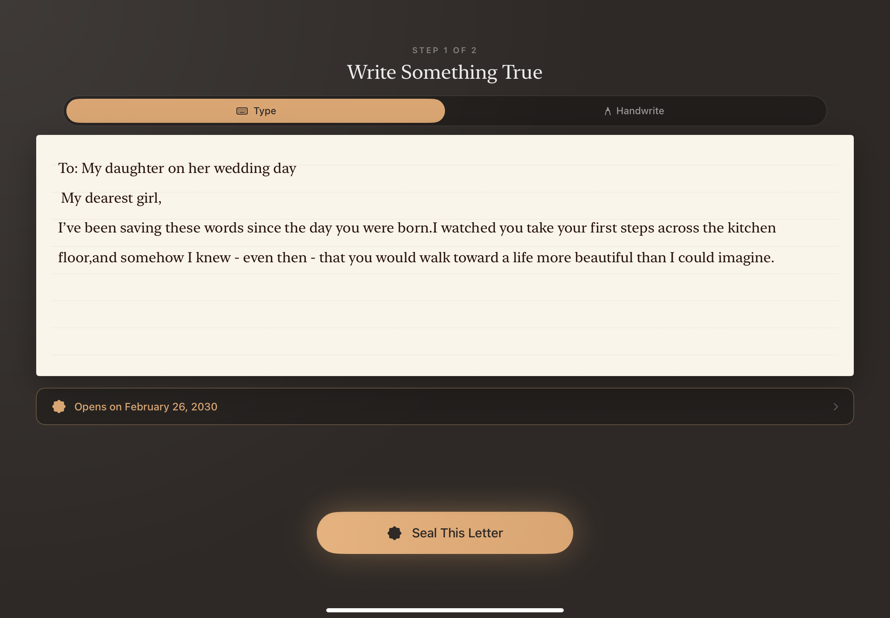
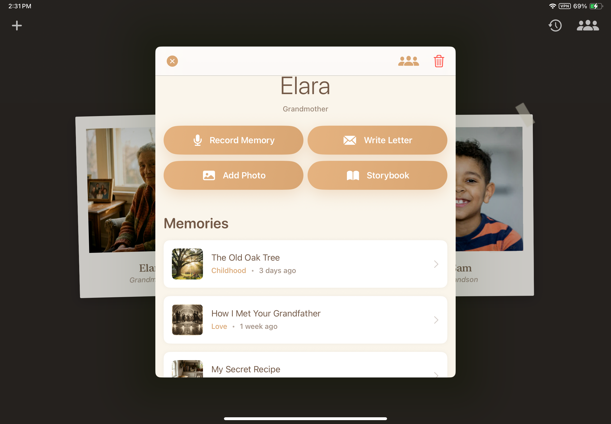
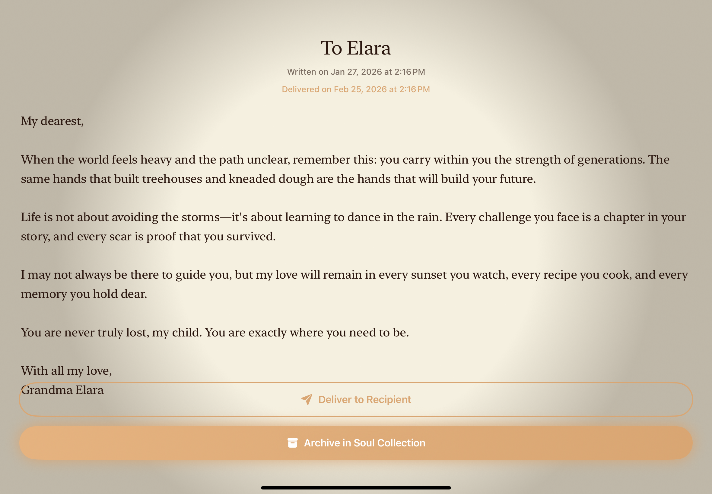

<div align="center">

# SoulNote
### *A Digital Heritage Vault*

**Preserve the voices, stories, and wisdom of those you love — forever.**

[](https://swift.org)
[](https://developer.apple.com/xcode/swiftui/)
[](https://www.apple.com/ios/)
[](https://developer.apple.com/augmented-reality/)
[](https://developer.apple.com/documentation/pencilkit)

</div>

---

## 🌿 The Vision

In a world of ephemeral notifications and fast-paced digital noise, **SoulNote** is a sanctuary.

It is built around a single, irreplaceable truth: *the voice of a grandmother reading a bedtime story, the handwriting of a father on a birthday card, the laughter of a loved one captured in an afternoon — these are treasures that technology has never truly cared to preserve.*

SoulNote changes that. It is a **Heirloom-First** iOS app designed with **Ritual, Reflection, and Respect** at its core — turning digital data into sacred artifacts meant to be passed down for generations.

> *"SoulNote moves from 'Information' to 'Emotion.' We don't just store data; we preserve **Presence**. While WhatsApp is for logistics, SoulNote is for **Legacy**."*

---

## 📱 Screenshots

<div align="center">

| Letter Writing | Heritage Profile | Letter Reading |
|:-:|:-:|:-:|
|  |  |  |
| *Write and seal time-locked letters on ivory paper* | *Preserve memories for each loved one* | *Open delivered letters in a ceremonial reading view* |

</div>

---

## ✨ Features

### 🎬 Cinematic First-Run Experience
The app opens with a **multi-stage cinematic intro screen** — breathing atmospheric gradients, floating particles, and carefully timed typographic reveals — before guiding new users through a reflective onboarding journey.

- **4-screen onboarding flow** with full-bleed thematic imagery
- **Guided First-Run Arc**: New users write and seal their very first letter as part of the onboarding ritual before ever reaching the dashboard
- Beautiful wax seal animation during the letter-sealing step
- Smooth transitions with glassmorphism and depth effects throughout

---

### 🏛 Soul Collection — The Intergenerational Dashboard
The main dashboard presents your preserved loved ones as **Polaroid-style archival memory cards** — a visual library that feels like opening an old photo album, not a contact list.

- **Archival Memory Cards** with photos, names, and relationship labels — each card subtly angled and animated into place
- **Add Loved One** flow with photo picker and relationship labeling
- **Empty state** with floating icon animation guiding first-time users
- Access to the **Memory Timeline** and **Legacy Tree** from the toolbar
- Full glassmorphism header with atmospheric grain texture background

---

### 👤 Heritage Profiles
Each person has a richly designed **profile page** that serves as their digital memorial.

- Photo display, name, and relationship context
- **4-action button grid** (2×2 layout) — Record Memory, Write Letter, Add Photo, Storybook
- Full letter archive with state indicators: **Scheduled**, **Delivered**, **Opened**, **Preserved**
- Memory recordings list with playback controls
- **AR Memory** launch button to experience memories in augmented reality
- State-aware letter row previews — handwritten letters show `✍️ Handwritten letter` instead of raw data

---

### 📸 Photo Memory — Add Photos Without Audio
Not every memory needs a voice recording. Sometimes you just want to preserve a photograph.

- Tap **Add Photo** from any heritage profile to open the photo memory sheet
- Pick a photo from the library — shown as a full-height preview
- Add a **caption** (e.g. *"Her 70th birthday, November 1998"*)
- Choose an **emotion tag** from the scrollable chip selector
- Saved as a `Memory` with `audioPath: nil` — appears in the profile's Memories section like any other memory
- No recording required — suitable for archiving old photos, scans, or screenshots

---

### 🎤 Voice-First Story Mode — Oral History Engine
An interactive, emotionally sensitive recording experience where SoulNote **interviews** your loved ones, guiding them through their own stories.

- **Guided interview prompts** with on-device speech recognition (`SpeechService`)
- **Real-time live transcription** displayed as the subject speaks
- Manual text entry fallback for accessibility
- **Emotion tagging**: each memory can be tagged (Joy, Nostalgia, Wisdom, Love, Gratitude) for later filtering and AR effects
- Memories are stored with audio file path, photo, transcript, and emotion tag
- **100% on-device**: no audio or transcription data ever leaves the device

---

### ✍️ The Writing Desk — Legacy Letters
An atmospheric, distraction-free space for writing letters to be opened in the future.

- **Ivory paper** rendered with grain texture and lined paper pattern
- **Dual input mode**: toggle between **Typed** and **Handwritten** modes with a smooth pill toggle
- **PencilKit handwriting canvas** — write letters by hand with Apple Pencil or finger
- **Heritage date picker** — choose a future unlock date with month/year wheel pickers
- Delivery date row with live preview of selected date
- Letters are sealed with a **wax seal animation** before being stored
- **Seal This Letter** button activates only when content is present (typed text or drawn strokes)

---

### 💌 Letter Delivery Ritual
When a letter's delivery date arrives, SoulNote triggers a ceremonial unlock experience.

- **Time-locked delivery**: letters remain sealed until their appointed date
- `UNUserNotificationCenter` delivers a notification when a letter is ready
- **Letter Delivery Unlock View**: a full-screen unlock ceremony when opening a delivered letter
- **3D paper unfold animation** as the letter reveals itself
- Letter reading view with sepia-toned paper, ink typography, and atmospheric vignette

---

### 📤 Handwritten Export — Deliver to Recipient
Once a letter is read, it can be shared as a **premium branded image** — not a plain text message.

- `ImageRenderer` captures the letter in high fidelity at device screen scale
- Exported image includes: **SOULNOTE watermark**, recipient name, delivery date, paper texture, and vignette
- `ShareLink` integration for sharing via Messages, WhatsApp, Email, AirDrop, etc.
- Exported letters look like **real pieces of history**, not chat bubbles

---

### 🌳 Legacy Tree — Visual Family Constellation
An interactive family map that helps younger generations see their heritage as a living, glowing network.

- Family members shown as **glowing constellation nodes** connected by animated threads
- Full-screen immersive presentation
- Node animations and gentle pulse effects

---

### 📜 Memory Timeline
A chronological view of all recorded memories across all people.

- Vertical **Memory Spine** layout with timeline markers
- Filter and browse memories across the entire soul collection
- Tappable memory entries for detail view and playback

---

### 🔮 AR Memory Portal — Spatial Memory Experience
The most immersive feature: place a memory as a **spatial, holographic object** in the real world using ARKit and RealityKit.

- **Full ARKit integration** with world-tracking, plane detection, and coaching overlay
- Tap a surface to **materialize** a memory — it appears with a particle aura and dissolve-in animation
- **Spatial audio playback**: the memory's recorded voice plays positionally — it gets louder as you walk toward it, softer as you step away
- **Emotion-based particle system**: floating particles reflect the memory's emotion tag (e.g., amber glow for Nostalgia, soft blue for Wisdom)
- **Proximity interaction system**: the visual aura and audio intensity dynamically respond to your distance from the placed memory
- Graceful fallback UI for unsupported devices

---

### 📖 Storybook Player
An audio-book-style experience for playing back recorded memory stories.

- Sequential story playback with ambient audio
- Visual player UI with controls
- `StorybookAudioManager` handling playback state

---

## 🎨 Design System

SoulNote uses a bespoke **Archival Design System** built from scratch in SwiftUI:

| Token | Description |
|---|---|
| `archiveBackground` | Warm charcoal `#2E2926` — the desk surface |
| `ivoryPaper` | Aged ivory `#FAF5EB` — paper and cards |
| `amberGlow` | Warm amber `#D9A572` — the signature accent |
| `amberGradient` | Gold-tinted CTA gradient |
| `introGradient` | Dusty peach → muted rose → deep plum |
| `inkColor` | Dark brown `#2B170F` — letter ink |
| `envelopePaper` | Aged cream for envelope surfaces |
| `waxSealColor` | Deep burgundy for wax seals |

**Motion principles**: breathing scale animations, film grain textures, vignette overlays, floating particle systems, glassmorphism panels, and spring-based micro-interactions throughout.

---

## 🛠 Tech Stack & Architecture

| Layer | Technology |
|---|---|
| **Language** | Swift 5.10+ |
| **UI Framework** | SwiftUI — 100% declarative, zero UIKit view controllers |
| **Augmented Reality** | ARKit + RealityKit (world-tracking, plane detection, spatial anchors) |
| **Handwriting** | PencilKit (`PKCanvasView`, `PKDrawing`) |
| **Audio Recording** | `AVFoundation` (`AVAudioRecorder`, `AVAudioPlayer`) |
| **Spatial Audio** | `AVAudioEngine` + 3D positioning node |
| **Speech Recognition** | `Speech` framework — fully on-device |
| **Notifications** | `UNUserNotificationCenter` — time-locked letter delivery |
| **Image Export** | `ImageRenderer` — high-fidelity letter-to-image capture |
| **Haptics** | `UIImpactFeedbackGenerator` via `HapticService` |
| **Persistence** | JSON-based local storage with `FileManager` for media |
| **Concurrency** | `MainActor`, `async/await`, `ObservableObject` |

---

## 🗂 Project Structure

```
SoulNote.swiftpm/
├── Package.swift                # Swift Playground App manifest
├── App.swift                    # App entry, onboarding flow, first-run arc
├── Models/
│   ├── Letter.swift             # Letter lifecycle, handwriting detection, display helpers
│   ├── Memory.swift             # Memory with emotion tags, audio/photo paths
│   ├── Person.swift             # Person profile model
│   └── StoryChapter.swift       # Storybook chapter model
├── Views/
│   ├── IntroView.swift          # Cinematic intro screen with breathing animations
│   ├── OnboardingView.swift     # 4-page feature onboarding with full-bleed images
│   ├── DashboardView.swift      # Soul Collection with Polaroid memory cards
│   ├── ProfileView.swift        # Heritage profile — 2×2 action grid, letters, memories
│   ├── AddPhotoMemoryView.swift # Photo-only memory — picker, caption, emotion tag
│   ├── LetterEditorView.swift   # Writing desk — typed & handwritten modes
│   ├── LetterReadingView.swift  # 3D paper unfold + letter reading experience
│   ├── LetterDeliveryUnlockView.swift  # Time-locked delivery ceremony
│   ├── SealedLetterAnimationView.swift # Wax seal animation sequences
│   ├── LegacyTreeView.swift     # Family constellation visualization
│   ├── MemoryTimelineView.swift # Chronological memory spine
│   ├── MemoryDetailView.swift   # Individual memory detail and playback
│   ├── RecordMemoryView.swift   # Voice-first story mode recording
│   ├── ARMemoryView.swift       # AR memory portal with spatial audio
│   ├── ARMemoryEntryView.swift  # AR entry ritual screen
│   └── StorybookPlayerView.swift # Audio storybook player
├── Services/
│   ├── MockDataService.swift    # Observable data store and persistence
│   ├── StorageService.swift     # JSON + FileManager persistence layer
│   ├── AudioService.swift       # AVFoundation recording and playback
│   ├── SpatialAudioController.swift # 3D positional audio for AR
│   ├── StorybookAudioManager.swift  # Storybook playback management
│   ├── SpeechService.swift      # On-device speech recognition
│   ├── LetterNotificationService.swift # Time-locked delivery notifications
│   ├── HapticService.swift      # Centralized haptic feedback
│   └── SoundService.swift       # UI sound effects
├── Components/
│   ├── CeremonialButton.swift   # Signature amber CTA button with press effects
│   ├── FloatingParticleSystem.swift # Atmospheric particle renderer
│   ├── HeritageDatePickerSheet.swift # Month/year wheel date picker
│   └── ...                      # Various reusable archival UI components
├── Utils/
│   ├── DesignTokens.swift       # Complete archival design system
│   └── UIImage+Loading.swift    # Smart image loader (asset catalog + bundle)
├── Resources/                   # Audio files (.m4a)
└── Assets.xcassets/             # Onboarding images, app icon, accent colors
```

---

## 🚀 Getting Started

### Requirements
- Xcode 26+ or Swift Playgrounds 4.6+
- iOS 16.0+ device or simulator
- Apple Developer account (for AR features and speech recognition on physical device)

### Running the App
1. Clone the repository
2. Open `SoulNote.swiftpm` in Xcode or Swift Playgrounds
3. Select your target device or simulator
4. Build and run (`⌘R`)

> **Note**: AR memory features require a physical iPhone or iPad with ARKit support. Speech recognition requires microphone permission. All data is stored locally — no backend or account required.

---

## 🔐 Privacy

SoulNote is designed with **privacy as a first principle**:

- ✅ All speech-to-text transcription happens **100% on-device** using Apple's Speech framework
- ✅ All recorded audio, photos, and letters are stored **only in the app's local sandbox**
- ✅ No analytics, no tracking, no cloud sync, no third-party SDKs
- ✅ No data ever leaves the device without explicit user action (share/export)

---

<div align="center">

*Built with care, for the people who matter most.*

**SoulNote** — *Because presence should never fade.*

</div>
